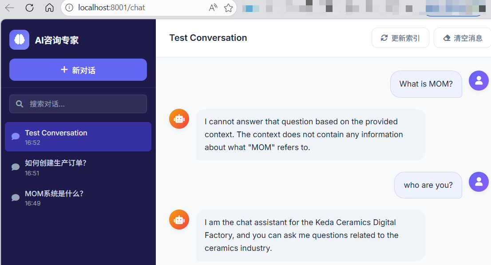

# 陶瓷制造知识库助手

基于 FastAPI + LlamaIndex 的 RAG 智能问答系统，面向陶瓷制造生产场景，支持流式对话、对话持久化和多会话管理。



## 项目结构

```
├── server.py              # FastAPI 主服务（SSE 流式问答 + 引用来源）
├── rag_engine.py          # 检索引擎：Milvus + 双路召回 + RRF 融合 + 精排 + 引用抽取
├── config.py              # 配置加载模块（YAML + 环境变量）
├── config.example.yaml    # 配置文件模板
├── config.yaml            # 实际配置（含 API Key，已 gitignore）
├── docker-compose.milvus.yml  # 可选：独立部署 Milvus standalone
├── pyproject.toml         # 项目依赖
├── templates/
│   ├── chat.html          # 聊天界面（含引用来源卡片渲染）
│   └── knowledge.html     # 知识库浏览界面（目录树 + 文件预览 + 搜索）
├── static/                # 静态文件
├── data_dir/
│   ├── knowledge_base/    # 知识库文档（唯一索引目录）
│   ├── conversations.db   # SQLite 对话数据库
│   ├── milvus.db/         # Milvus Lite 向量库
│   └── storage/           # 索引清单与本地文档库
├── docs/
│   ├── knowledge_base_standard.md  # 知识库目录、命名与入库规范
│   └── architecture.md    # 检索架构说明
├── llms/                  # 模型缓存目录
└── imgs/                  # 截图
```

知识库按主题分为 `00_原料与配方`、`01_生产工艺`、`02_设备与窑炉`、`03_质量与检测`、
`04_标准与规范`、`05_生产管理`、`06_外部资料`，新增文档请遵循
[`docs/knowledge_base_standard.md`](docs/knowledge_base_standard.md)。

## 检索架构（Milvus + 双路召回 + RRF + 精排 + 引用溯源）

```
用户问题
   ├── 稠密召回：Milvus 向量库（bge 中文向量，余弦相似度）
   └── 稀疏召回：jieba 分词 + BM25（型号/编号/专有名词等关键词精确匹配）
         ↓
   RRF 融合：score(d) = Σ weight_c / (k + rank_c(d))     ← 只看排名，无需对齐两路分数量纲
         ↓
   bge-reranker 精排：把「问题 + 候选片段」拼在一起逐条打分，按相关度截断到 top_n
         ↓
   大模型生成答案（正文带 [1][2] 编号引用）→ 前端渲染「引用来源」卡片 + 检索链路
```

实现文件：`rag_engine.py`（`RAGEngine`）。架构图（Mermaid 源码 + 渲染图）见 [`docs/architecture.md`](docs/architecture.md)。关键设计：

- **向量库**：Milvus。`vector_store.uri` 填本地文件路径即用 **Milvus Lite**（零部署、嵌入式，开发/单机）；
  填 `http://host:19530` 即连**独立部署的 Milvus**（生产/多实例），代码与 API 完全一致，只换配置。
- **稀疏一路**：中文不能按默认 token 规则切（整句会变成一个 token），因此索引与查询两侧都走
  jieba 分词 + 小停用词表，再交给 bm25s 计算 BM25 分数。
- **融合**：显式实现 RRF（而不是黑盒调用），因此每一路召回了哪些片段、各自排名多少都能在响应里看到。
- **精排**：`BAAI/bge-reranker-base`（Cross-Encoder）。`score_mode: auto` 会自动识别模型输出是概率还是 logits；
  `min_relevance` 是相关性阈值，低于阈值的片段既不送给大模型、也不作为引用 —— 知识库外的问题会直接回答
  “知识库中没有找到相关资料”，而不是硬凑几条无关引用。
- **引用来源**：最终每条片段都带文件名、片段序号、相关度、RRF 分数以及命中通道（稠密 / 稀疏 / 双路），
  前端在回答下方渲染引用卡片，随消息一起落库（历史对话可回显引用）。
- **增量索引**：`data_dir/storage/manifest.json` 记录文件内容 sha1；文档没变就跳过切分与嵌入，
  复用 Milvus 集合与本地文档库（重启秒级就绪）。
- **可观测**：每次问答都返回检索链路（各阶段命中数、耗时）与首 token 耗时，方便调参与效果对比。

### 检索参数（config.yaml）

| 配置项 | 说明 | 默认 |
| --- | --- | --- |
| `vector_store.uri` | Milvus 地址：本地文件 = Lite；http URL = 独立服务 | `data_dir/milvus.db` |
| `vector_store.collection` | 集合名 | `mom_chat_chunks` |
| `retrieval.dense.top_k` | 稠密召回条数 | 10 |
| `retrieval.sparse.top_k` | 稀疏召回条数 | 10 |
| `retrieval.fusion.k` / `weights` / `top_k` | RRF 平滑常数 / 两路权重 / 进入精排的候选数 | 60 / [1,1] / 10 |
| `retrieval.rerank.top_n` | 最终送大模型的片段数 | 5 |
| `retrieval.rerank.min_relevance` | 相关度阈值（低于则丢弃） | 0.02 |
| `chunking.chunk_size` / `chunk_overlap` | 切分粒度 | 512 / 64 |

想把某一路关掉做消融对比，把 `retrieval.dense.enabled` 或 `retrieval.sparse.enabled` 置为 `false` 即可
（答案下方会显示“稠密召回 关闭 / 稀疏召回 9”这类链路信息）。

### 独立部署 Milvus（可选）

```bash
docker compose -f docker-compose.milvus.yml up -d      # etcd + minio + milvus standalone
# 然后 config.yaml:  vector_store.uri: http://localhost:19530
```

> 注意：**Milvus Lite（本地文件模式）同一时刻只允许一个进程访问该数据文件**。
> 如果启动时报“Milvus 本地数据文件被另一个进程占用”，说明已有实例在跑；关掉旧实例，
> 或改用上面的独立部署 Milvus（支持多实例/并发部署）。

## 快速开始

### 1. 配置

```bash
cp config.example.yaml config.yaml
```

编辑 `config.yaml`，填入真实的 API Key：

```yaml
llm:
  api_key: "your-deepseek-api-key"

aliyun:
  access_key_id: "your-aliyun-key"
  access_key_secret: "your-aliyun-secret"
```

> 敏感字段也支持通过环境变量覆盖，如 `APP_LLM__API_KEY=sk-xxx`，
> 其余配置同理：`APP_VECTOR_STORE__URI=http://localhost:19530`。

### 2. 安装依赖

```bash
pip install -r requirements.txt
# 或使用 uv
uv sync
```

首次启动会自动下载嵌入模型 `BAAI/bge-small-zh-v1.5` 与精排模型 `BAAI/bge-reranker-base`
（经 ModelScope，缓存在 `llms/`，精排模型约 1.1G）。

### 3. 启动服务

```bash
python server.py
# 或指定端口
python server.py --port 8080
```

访问 `http://localhost:8001/chat` 开始问答，`http://localhost:8001/knowledge` 浏览知识库。

## 功能特性

- **流式对话** — AI 回复逐字输出（SSE），阅读体验流畅
- **知识库浏览** — 目录树、Markdown/CSV/文本预览、文件名与正文搜索、原文下载
- **Milvus 向量库** — Milvus Lite 本地文件 / 独立 Milvus 服务，配置切换
- **双路召回 + RRF + 精排** — 稠密向量 + BM25 关键词两路召回，RRF 融合后由 bge-reranker 精排
- **引用来源** — 回答带 [1][2] 编号，下方展示来源文件、片段、相关度与命中通道，随对话落库
- **检索链路可见** — 每次回答都返回稠密/稀疏/融合/精排各阶段命中数与耗时，便于调参与讲解
- **对话持久化** — SQLite 存储所有对话和历史消息，刷新不丢失（引用来源一并保存）
- **多会话管理** — 侧边栏管理多个对话，支持搜索、重命名、删除
- **增量索引** — 文档未改动时跳过切分与嵌入，重启秒级就绪
- **配置分离** — API Key 等敏感信息从配置文件加载，支持环境变量覆盖
- **响应式设计** — 适配桌面和移动端

## API 接口

| 方法 | 端点 | 说明 |
|------|------|------|
| GET | `/chat` | 聊天界面 |
| GET | `/knowledge` | 知识库浏览界面 |
| GET | `/api/knowledge/tree` | 知识库目录树与文件统计 |
| GET | `/api/knowledge/file?path=...` | 读取文件内容（Markdown/文本/CSV 表格） |
| GET | `/api/knowledge/search?q=...` | 按文件名和正文搜索知识库 |
| GET | `/api/knowledge/download?path=...` | 下载知识库原文 |
| POST | `/stream-query` | 流式 RAG 查询（SSE：`retrieval` → `token`* → `sources` → `done`） |
| POST | `/query` | 非流式查询（返回答案 + 引用来源 + 检索链路） |
| POST | `/update-index` | 重建索引（重新切分、写入 Milvus、重建 BM25） |
| GET | `/api/index-status` | 检索链路状态（向量库位置、片段数、召回/精排配置） |
| GET | `/api/conversations` | 获取对话列表 |
| POST | `/api/conversations` | 创建新对话 |
| DELETE | `/api/conversations/{id}` | 删除对话 |
| PUT | `/api/conversations/{id}` | 重命名对话 |
| GET | `/api/conversations/{id}/messages` | 获取对话消息（含引用来源元数据） |
| POST | `/api/conversations/{id}/messages` | 添加消息 |

### `/stream-query` SSE 事件

```
event: retrieval   data: {"trace": {"dense": {...}, "sparse": {...}, "fusion": {...}, "rerank": {...}}}
event: token       data: {"text": "球磨机"}
event: sources     data: {"sources": [{"index": 1, "file_name": "...", "chunk": 2, "relevance": 0.998,
                                       "rrf_score": 0.0328, "channels": ["稠密", "稀疏"],
                                       "dense_rank": 1, "sparse_rank": 2, "snippet": "..."}],
                          "trace": {...}, "timings": {"retrieval_ms": 1350.2, "first_token_ms": 3120.5}}
event: done        data: {"conversation_id": "...", "timings": {...}}
```

## 技术栈

- **FastAPI** — 异步 Web 框架
- **LlamaIndex** — RAG 编排（索引/检索器/精排后处理）
- **Milvus** — 向量库（Milvus Lite 嵌入式 / standalone 独立部署）
- **jieba + bm25s** — 中文分词与 BM25 稀疏召回
- **bge-reranker-base** — Cross-Encoder 精排
- **DeepSeek** — 大语言模型
- **HuggingFace** — 嵌入模型 (bge-small-zh-v1.5)
- **SQLite** — 对话与引用元数据持久化
- **Jinja2** — 模板引擎
