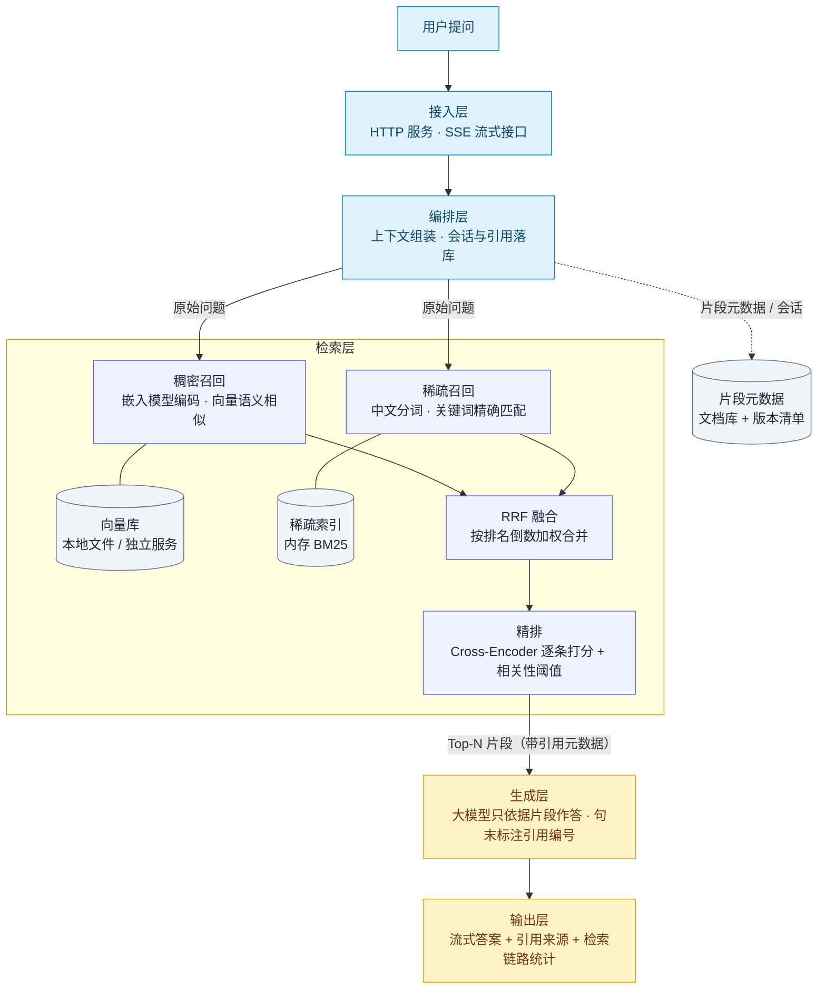
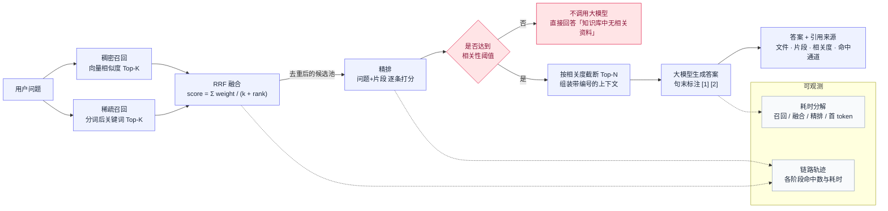
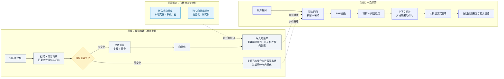

# mom_chat 检索架构图（Mermaid）

> 说明：三张图分别对应「整体分层架构」「单次问答的检索链路」「离线索引与部署形态」。
> 已在 mermaid.ink 上渲染校验通过（中文标签正常），渲染产物见 `docs/diagrams/`。
> 抽象术语，可直接用于技术分享材料。

## 一、整体分层架构

## 二、单次问答的检索链路

## 三、离线索引与部署形态

## 术语对照（抽象 → 本项目实现）

| 抽象术语 | 本项目实现 |
| --- | --- |
| 接入层 | FastAPI + SSE（`/stream-query`） |
| 编排层 | `rag_engine.RAGEngine` 提示词组装、引用抽取、会话落库 |
| 稠密召回 | Milvus 向量检索（bge-small-zh-v1.5，余弦相似度） |
| 稀疏召回 | jieba 分词 + bm25s（BM25，k1=1.5、b=0.75） |
| 融合 | RRF（k=60，两路权重可配） |
| 精排 | bge-reranker-base（Cross-Encoder）+ 相关性阈值过滤 |
| 生成层 | DeepSeek（`deepseek-reasoner`）流式生成 |
| 片段元数据 | `data_dir/storage/`（docstore + manifest 版本清单） |
